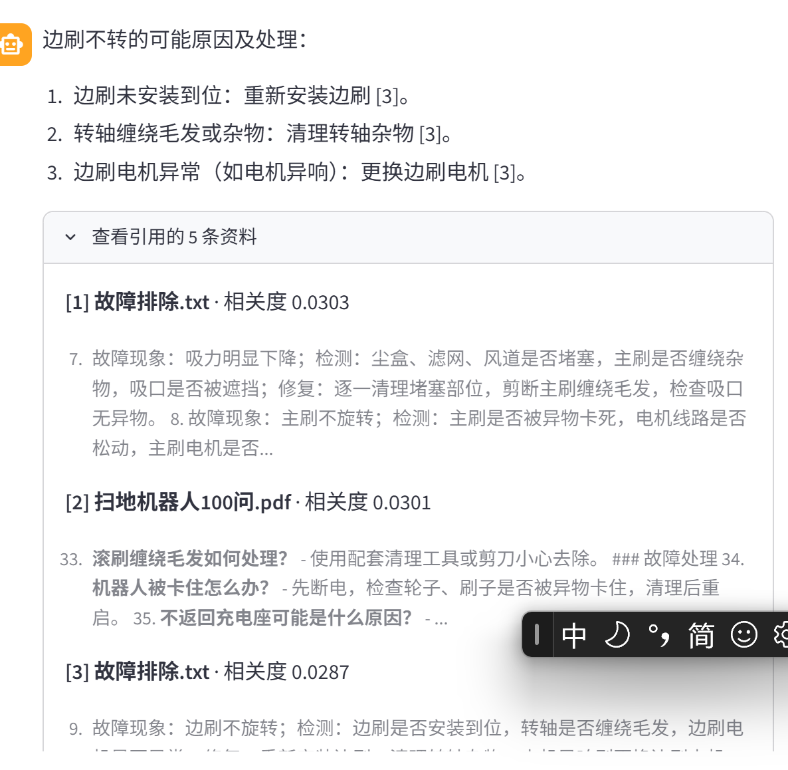
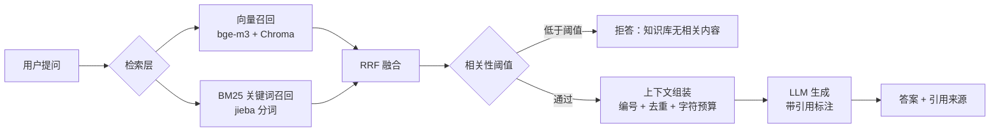

# 智扫通 · 扫地机器人知识库问答（RAG）



一个面向扫地机器人售前/售后场景的知识库问答应用：用户提问 → 检索知识库 → 大模型基于命中片段作答，并给出引用来源。

在开源项目 [shangxiang0907/HeiMa-AI-LLM-RAG-Agent-Dev](https://github.com/shangxiang0907/HeiMa-AI-LLM-RAG-Agent-Dev) 的基础上优化而来。

---

## 一、这个项目做了什么

| 能力 | 说明 |
|---|---|
| 知识库问答 | 6 份扫地机器人资料（约 13 万字）切块入向量库，按问题召回相关片段 |
| 混合检索 | 向量召回 + BM25 关键词召回，用 RRF 融合 |
| 引用标注 | 回答里的结论带 `[1][2]`，界面上可展开看命中的原文 |
| 无依据拒答 | 检索相关性低于阈值时直接说"知识库里没有"，不硬编答案 |
| 多轮对话 | Streamlit 会话内保留上下文 |

---

## 二、相对上游做了哪些改动

上游是一个完整的"智能客服 Agent"：Streamlit → ReactAgent（ReAct 决策 + 工具调用 + 埋点）→ 工具里再调 RAG。
本项目**只保留 RAG 主链路**，去掉 Agent 层，并在检索和生成上做了三处小改进。

### 改动 1：检索从"纯向量"改为"向量 + BM25"混合召回

- **上游做法**：`vector_store.as_retriever(search_kwargs={"k": 3})`，只有一路向量召回。
- **问题**：向量擅长语义相近，但对型号、数字、专有名词不敏感。问"X10 的尘盒容量"，向量容易召回一堆泛泛的"选购建议"，而真正写着参数的那段因为措辞不同被漏掉。
- **做法**：加一路 BM25（jieba 中文分词），两路结果用 RRF 融合：

  ```
  score(d) = Σ 1 / (60 + rank_i(d))
  ```

  只用排名不用分数——余弦相似度是 0~1，BM25 分数是 0~几十，量纲不同，加权相加没有意义。
- **验证方式**：`scripts/compare_retrieval.py` 对同一批问题分别跑两种检索，输出命中片段与重叠度（Jaccard）。

### 改动 2：上下文组装从"截断"改为"去重 + 编号 + 预算"

- **上游做法**：取前 `top_k` 条，拼接后按 4000 字符硬截断。
- **问题**：截断可能把某一条切在句子中间；同一个文档的相邻块会重复占预算；模型也拿不到"这句话出自哪里"。
- **做法**：按融合分数排序 → 单条限长 → 带编号和来源拼接 → 总预算 3000 字符，剩余不足时按整块丢弃而不是切半句。编号同时回传给界面，用于渲染引用。

### 改动 3：真正用上配置里的相关性阈值（拒答）

- **上游做法**：`config/rag.yml` 里写了 `score_threshold: 0.3`，但检索代码里**从未读取**，等于配置形同虚设。
- **做法**：用向量相关性分数做闸门，低于阈值直接返回"知识库中没有找到相关内容"，并把 `abstained` 标记透出给界面。
- **价值**：客服场景里，**编一个错误参数比说"不知道"更糟**。拒答率是可以被度量的指标。

### 其他调整

- 去掉 Agent、工具、埋点、用户使用报告（`records.csv`）等与 RAG 无关的模块。
- 精简依赖：去掉 `langchain`、`langchain-community`、`langchain-ollama`、`dashscope`等不了解的板块

---

## 三、架构



---

## 四、快速开始

```powershell
cd zhisaotong-rag

# 1. 建环境（用 uv 管理的 Python 3.12，不污染系统 Python）
& "$env:USERPROFILE\.local\bin\uv.exe" venv --python 3.12 .venv
& "$env:USERPROFILE\.local\bin\uv.exe" pip install --python .venv\Scripts\python.exe -r requirements.txt

# 2. 配置 Key
copy .env.example .env
notepad .env        # 填 DEEPSEEK_API_KEY 和 OPENAI_API_KEY

# 3. 建索引（第一次约 1-2 分钟）
.\.venv\Scripts\python.exe scripts\build_index.py

# 4. 对比两种检索方式
.\.venv\Scripts\python.exe scripts\compare_retrieval.py

# 5. 启动界面
.\.venv\Scripts\python.exe -m streamlit run app.py
```

浏览器打开 http://localhost:8501 即可。

---

## 五、目录结构

```
zhisaotong-rag/
├── app.py                      # 入口（把 src/ 加进路径后启动界面）
├── requirements.txt
├── pyproject.toml
├── .env.example
├── scripts/
│   ├── build_index.py          # 建索引
│   └── compare_retrieval.py    # 纯向量 vs 混合检索 对比
└── src/zhisaotong_agent/
    ├── app.py                  # Streamlit 界面
    ├── rag/
    │   ├── vector_store.py     # 文档加载、切分、Chroma 建库（沿用上游）
    │   ├── hybrid_retriever.py # 新增：BM25 + RRF 融合
    │   └── rag_service.py      # 重写：检索 → 组装 → 生成 → 拒答
    ├── model/factory.py        # 重写：OpenAI 兼容的模型工厂
    ├── prompts/rag_summarize.txt  # 重写：带引用要求的提示词
    ├── config/                 # 配置（切块参数、top_k、阈值）
    ├── data/                   # 知识库原始文件
    └── utils/                  # 配置加载、日志、文件读取（沿用上游）
```


---

## 六、已知限制

- BM25 索引在内存里构建，知识库上万块后需要换成数据库侧全文索引。
- 拒答阈值依赖向量相关性分数的量纲，换 embedding 模型后要重新标定。
- 单轮检索，未做多轮指代消解（"它多少钱"这类问题需要用户补全主语）。
- 界面只做单用户本地使用，没有鉴权。

---

## 七、实测结果

测试条件：6 份文档、**326 个分块**（chunk_size=200，overlap=20）、bge-m3（1024 维）、top_k=5。

| 问题 | 纯向量 | 混合检索 | 召回重合度 |
|---|---|---|---|
| 尘盒多久清理一次 | 96 ms | 89 ms | 0.67 |
| 扫地机器人充不进电怎么办 | 132 ms | 91 ms | 0.25 |
| 边刷不转了是什么原因 | 108 ms | 92 ms | 0.43 |

值得一提的点：

1. **召回重合度 0.25–0.67**，说明两路检索确实在互补，而不是重复劳动。
2. **混合检索没有变慢**（89–92 ms vs 96–132 ms）。BM25 索引常驻内存，代价可以忽略；延迟主要由 embedding 接口决定。

具体案例（问题：「边刷不转了是什么原因」）：

| 排名 | 纯向量 | 混合检索 |
|---|---|---|
| 1 | 边刷旋转时偏心 | 吸力明显下降 |
| 2 | 边刷安装后松动 | 滚刷缠绕头发 |
| 3 | **WiFi 信号中断（跑题）** | **边刷不旋转（命中）** |
| 4 | 吸力明显下降 | 边刷旋转时偏心 |
| 5 | 边刷磨损过快 | 边刷安装后松动 |

纯向量把「WiFi 断网」排进了前三，而真正写「边刷不旋转」的第 9 条**没进前五**；BM25 靠「边刷」「不转」的精确词匹配把它拉了回来。


---

## 八、致谢

原始项目：[shangxiang0907/HeiMa-AI-LLM-RAG-Agent-Dev](https://github.com/shangxiang0907/HeiMa-AI-LLM-RAG-Agent-Dev)
本项目借鉴其文档加载、文本切分、Chroma 封装、配置与日志工具部分，优化了检索融合、上下文组装、拒答逻辑与前端。
